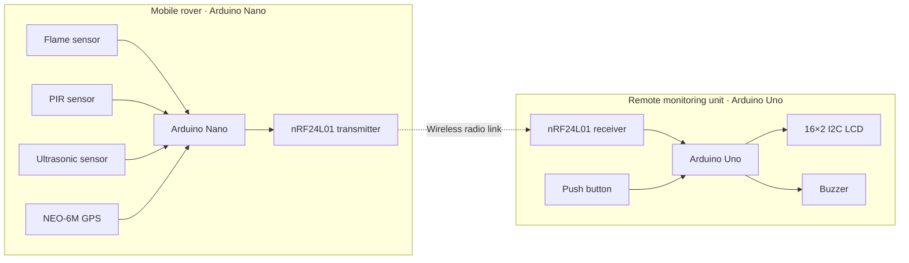

<div align="center">

# SENTINELROVER

### Detect · Monitor · Locate · Alert

**A tracked, multi-purpose robotic monitoring prototype built with Arduino, GPS, wireless communication and environmental sensors.**


</div>

---

## Overview

SentinelRover is a tracked robotic monitoring system designed to collect information about its surroundings, obtain geographical data, and send readings to a separate operator-side receiver.

The project uses two microcontrollers:

- **Rover unit:** Arduino Nano reads the sensors and NEO-6M GPS module, then transmits a structured data packet.
- **Receiver unit:** Arduino Uno receives the packet, displays GPS information on a 16×2 I2C LCD, and generates configured audio alerts.

The two units communicate using nRF24L01 radio modules. The receiver's push button switches between three LCD pages.

> **Project scope:** This repository documents the supplied working prototype and its current firmware. Potential applications are educational and demonstrational; the system is not a certified safety or emergency-response device.

## Key capabilities

| Capability | Implementation |
|---|---|
| Mobile platform | Tracked robotic chassis |
| Rover controller | Arduino Nano |
| Receiver controller | Arduino Uno |
| Wireless link | nRF24L01 modules |
| GPS | NEO-6M |
| Flame monitoring | Digital flame sensor |
| Motion sensing | PIR sensor |
| Proximity measurement | HC-SR04-style ultrasonic interface (TRIG/ECHO) |
| Operator display | 16×2 I2C LCD |
| Display navigation | Tactile push button |
| Audio notification | Buzzer |
| GPS information | Latitude, longitude, speed, altitude, satellite count and fix status |

## System architecture



## Repository structure

```text
sentinel-rover/
├── firmware/
│   ├── transmitter/
│   │   └── SentinelRover_Transmitter.ino
│   └── receiver/
│       └── SentinelRover_Receiver.ino
├── docs/
│   ├── COMPLETE_PROJECT_DOCUMENTATION.md
│   ├── PROJECT_OVERVIEW.md
│   ├── HARDWARE_AND_WIRING.md
│   ├── SYSTEM_ARCHITECTURE.md
│   ├── SETUP_AND_OPERATION.md
│   ├── TROUBLESHOOTING.md
│   └── FUTURE_SCOPE.md
├── .gitignore
├── CONTRIBUTING.md
├── LICENSE-INFO.md
└── README.md
```

## Hardware

### Rover transmitter

- Arduino Nano
- nRF24L01 module
- NEO-6M GPS module
- Digital flame sensor
- PIR motion sensor
- Ultrasonic distance sensor
- Tracked robotic chassis and its motor-control hardware

### Remote receiver

- Arduino Uno
- nRF24L01 module
- 16×2 I2C LCD (configured for address `0x27`)
- Tactile push button
- Buzzer

See [Hardware and Wiring](docs/HARDWARE_AND_WIRING.md) before connecting components.

## Software requirements

Install the following Arduino libraries through **Arduino IDE → Library Manager**:

| Library | Used by |
|---|---|
| RF24 | Transmitter and receiver |
| TinyGPSPlus | Transmitter |
| LiquidCrystal_I2C | Receiver |

`SPI`, `Wire`, and `SoftwareSerial` are included with the Arduino AVR core used by the Nano/Uno boards.

## Getting started

1. Open `firmware/transmitter/SentinelRover_Transmitter.ino` in Arduino IDE.
2. Select **Arduino Nano**, choose the correct processor/bootloader option for your board, select its port, and upload.
3. Open `firmware/receiver/SentinelRover_Receiver.ino`.
4. Select **Arduino Uno**, select its port, and upload.
5. Power the nRF24L01 modules with a suitable stable **3.3 V supply**. Do not connect an nRF24L01 VCC pin to 5 V.
6. Power both units, allow the GPS module time and a suitable view of the sky to obtain a fix, and check the receiver LCD.

For full pin assignments, operating behaviour, and troubleshooting, use the documentation in `docs/`.

## Receiver LCD pages

| Page | Line 1 | Line 2 |
|---|---|---|
| 1 | Latitude | Longitude |
| 2 | Speed (km/h) | Altitude (m) |
| 3 | Satellite count | GPS fix status |

Press the receiver push button to move to the next page. The receiver firmware displays a waiting message before the first packet and a signal-lost message after its configured timeout.

## Alert behaviour in the supplied firmware

- A flame condition triggers the receiver's flame warning and buzzer.
- A measured distance below `ALERT_DISTANCE_CM` (default: **20 cm**) triggers the object warning and buzzer.
- The PIR state is transmitted in the packet, but the current receiver sketch does not display or trigger a dedicated PIR alert.
- The ultrasonic function reports `999` when no echo is received; this is treated as no close-object alert by the current threshold check.

These details describe the code in this repository, not a guarantee of sensor accuracy.

## Important implementation notes

- The `SensorPacket` structure must remain consistent between transmitter and receiver. If its fields or types change, update both sketches together.
- Both radios use the same pipe address (`SNTNL`), data rate (`250KBPS`) and low power setting in the supplied code.
- The supplied sketches do not contain motor-driver control logic. The tracked chassis is part of the physical platform, but drive-control firmware is not included in these two files.
- The GPS TX/RX labels are from the microcontroller's perspective: Nano D6 receives from GPS TX; Nano D7 transmits to GPS RX.
- The receiver assumes LCD I2C address `0x27`; some LCD backpacks use another address.

## Documentation

- [Complete project documentation](docs/COMPLETE_PROJECT_DOCUMENTATION.md)
- [Project overview](docs/PROJECT_OVERVIEW.md)
- [Hardware and wiring](docs/HARDWARE_AND_WIRING.md)
- [System architecture](docs/SYSTEM_ARCHITECTURE.md)
- [Setup and operation](docs/SETUP_AND_OPERATION.md)
- [Troubleshooting](docs/TROUBLESHOOTING.md)
- [Future scope](docs/FUTURE_SCOPE.md)

## Development status

The project is described by its developer as a **fully working prototype**. The repository contains the two supplied Arduino firmware sketches and supporting technical documentation. It does not claim that future-scope features—such as autonomous navigation, camera streaming, map dashboards or data logging—are already implemented.

## Contributing

Suggestions, documentation improvements and tested firmware enhancements are welcome. Please read [CONTRIBUTING.md](CONTRIBUTING.md) before proposing changes.

## License

No open-source license has been assigned in this repository yet. See [LICENSE-INFO.md](LICENSE-INFO.md). Until a license is added, the default copyright rules apply.

---

<div align="center">

**SENTINELROVER — DETECT. MONITOR. LOCATE. ALERT.**

</div>